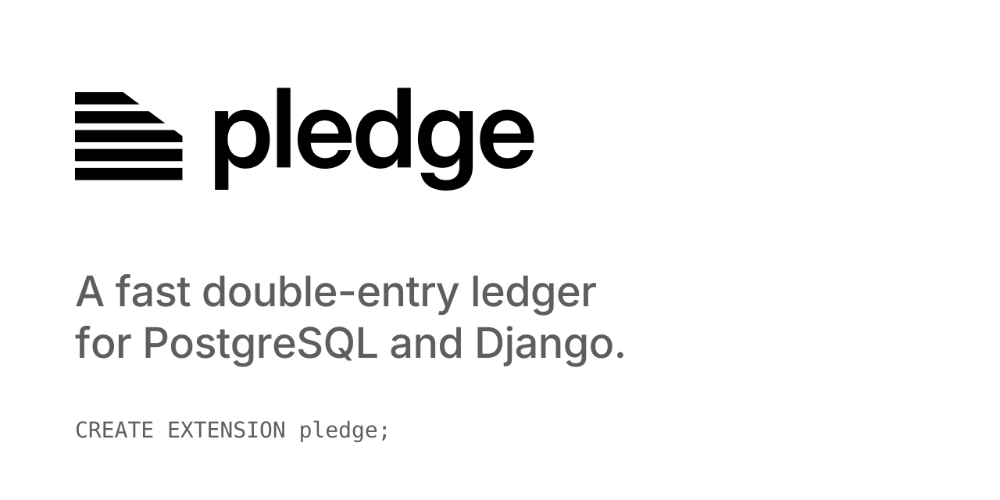

<picture>
  <source media="(prefers-color-scheme: dark)" srcset="docs/public/pledge-social-dark-square.svg">
  
</picture>

<p align="center">
  <a href="https://pgpledge.github.io/pledge/"><strong>Documentation</strong></a> ·
  <a href="https://pgpledge.github.io/pledge/install/">Install</a> ·
  <a href="https://pgpledge.github.io/pledge/sql/transfers/">Transfers</a> ·
  <a href="https://pgpledge.github.io/pledge/sql/errors/">Errors</a> ·
  <a href="https://pgpledge.github.io/pledge/django/setup/">Django</a> ·
  <a href="python/example">Example</a> ·
  <a href="bench/README.md">Benchmarks</a> ·
  <a href="https://pypi.org/project/django-pledge/">PyPI</a>
</p>

<p align="center">
  <a href="https://github.com/pgpledge/pledge/actions/workflows/extension.yml"></a>
  <a href="https://github.com/pgpledge/pledge/actions/workflows/python.yml"></a>
  <a href="https://github.com/pgpledge/pledge/actions/workflows/docs.yml"></a>
</p>

pledge grew out of [pgledger], Paul Gross's double-entry ledger in plain SQL, which is already in
use. We kept its model, rewrote the hot path in Rust, and still benchmark against it. pledge itself
is young: it works and is validated, including a replay of a real bank's million transactions,
but the API may still change before 1.0. Feedback is very welcome.

## A quick look

```sql
CREATE EXTENSION pledge;

SELECT id FROM pledge.create_account('bank', 'USD');
-- pla_01M730CQFEF2CR8VRK2DCTVZ7P
SELECT id FROM pledge.create_account('alice', 'USD', allow_negative_balance => false);
-- pla_01M730CQFHFJQ9TRR4FW8SYK2Y

SELECT * FROM pledge.create_transfer('pla_01M730CQFEF2CR8VRK2DCTVZ7P', 'pla_01M730CQFHFJQ9TRR4FW8SYK2Y', 100.00);

SELECT name, balance FROM pledge.accounts_view ORDER BY name;
--  alice |  100.00
--  bank  | -100.00
```

## Why pledge

- **Correct by default.** Every transfer writes two entries that sum to zero, and each entry
  stores the account's running balance.
- **Safe to retry.** Send your own transfer id; the same transfer twice is booked once.
- **Hard to tamper with.** The database refuses to delete ledger rows or change amounts.
- **Fast.** Written in Rust with [pgrx]; about 1.5 to 2 times faster than [pgledger] per
  transfer, and about 2 times faster for batches.
- **Clear errors.** Each failure has a stable code, like `pledge.negative_balance_not_allowed`.

Runs on PostgreSQL 17 and 18.

## Django

[django-pledge](python/) gives you `Account`, `Transfer` and `Entry` models over the ledger,
written through the usual Django API.

```sh
pip install django-pledge
```

```python
from django_pledge.models import Account

cash = Account.objects.create(name="cash", currency="EUR")
alice = Account.objects.create(name="alice", currency="EUR", allow_negative_balance=False)
cash.transfer(alice, 10)
```

See the [Django docs](https://pgpledge.github.io/pledge/django/setup/) and the
[exchange example](python/example), a small currency exchange built on it.

## Develop

Everything runs in Docker through [just](https://github.com/casey/just):

```sh
just up            # PostgreSQL 18 with pledge
just psql          # open psql
just docker-test   # cargo pgrx test, clippy and fmt
just validate      # bank, model and Berka validation suites
just docker-bench  # pgbench: pledge vs pgledger
just example       # exchange example on http://localhost:8000
```

## Is it any good?

[Yes.](http://news.ycombinator.com/item?id=3067434)

## Credits

Thanks to Paul Gross for [pgledger], the ledger pledge started from. Ideas also came from Modern
Treasury, Blnk and Formance.

Made by [terminalkitten](https://github.com/terminalkitten).

## License

[MIT](LICENSE)

[pgrx]: https://github.com/pgcentralfoundation/pgrx
[pgledger]: https://github.com/pgr0ss/pgledger
